# Results (generated by scripts/build_results_md.py — do not edit by hand)

## PRELIMINARY — laptop pilot, 64 px, our core, 8 samples/image

> **Preliminary.** Small-scale CPU pilot used to validate the pipeline; not the final experiment.

| factor | level | n_images | struct_dev | endpoint_excess | mean_seg_len_ratio | grey_ratio | edge_density_ratio | junction_hist_l1 | orientation_conformity | spectral_peak_recall | patch_swd | patch_precision | patch_recall | block_copy_ratio | lpips_div |
|---|---|---|---|---|---|---|---|---|---|---|---|---|---|---|---|
| density | 10.0 | 2 | 0.141 | 0.729 | 1.000 | 1.048 | 1.028 | 0.304 | 0.526 | 1.000 | 0.033 | 0.679 | 0.030 | 0.000 | 0.030 |
| density | 2.0 | 2 | 0.002 | 1.000 | 0.996 | 1.001 | 1.001 | 0.000 | 0.881 | 1.000 | 0.016 | 0.951 | 0.030 | 0.000 | 0.087 |
| density | 5.0 (base) | 2 | 0.066 | 1.030 | 0.995 | 1.078 | 1.075 | 0.067 | 0.946 | 0.953 | 0.021 | 0.879 | 0.030 | 0.000 | 0.052 |
| junctions | T | 2 | 0.056 | 1.069 | 1.005 | 1.048 | 1.038 | 0.000 | 0.989 | 1.000 | 0.008 | 0.962 | 0.043 | 0.000 | 0.033 |
| junctions | none | 2 | 0.039 | 1.027 | 1.000 | 1.041 | 1.042 | 0.000 | 1.000 | 1.000 | 0.007 | 0.977 | 0.003 | 0.000 | 0.032 |
| junctions | X (base) | 2 | 0.066 | 1.030 | 0.995 | 1.078 | 1.075 | 0.067 | 0.946 | 0.953 | 0.021 | 0.879 | 0.030 | 0.000 | 0.052 |
| length | short | 2 | 0.030 | 0.985 | 0.995 | 1.038 | 1.025 | 0.036 | 0.518 | 0.992 | 0.009 | 0.995 | 0.267 | 0.000 | 0.042 |
| length | long (base) | 2 | 0.066 | 1.030 | 0.995 | 1.078 | 1.075 | 0.067 | 0.946 | 0.953 | 0.021 | 0.879 | 0.030 | 0.000 | 0.052 |
| periodicity | jitter | 2 | 0.030 | 0.986 | 1.018 | 1.025 | 1.011 | 0.069 | 0.948 | 0.992 | 0.018 | 0.968 | 0.103 | 0.000 | 0.054 |
| periodicity | random | 2 | 0.061 | 1.028 | 1.065 | 1.055 | 1.027 | 0.012 | 0.961 | 0.984 | 0.020 | 0.953 | 0.118 | 0.000 | 0.059 |
| periodicity | perfect (base) | 2 | 0.066 | 1.030 | 0.995 | 1.078 | 1.075 | 0.067 | 0.946 | 0.953 | 0.021 | 0.879 | 0.030 | 0.000 | 0.052 |
| text | sparse | 2 | 0.043 | 1.008 | 1.006 | 1.056 | 1.043 | 0.097 | 0.852 | 1.000 | 0.017 | 0.999 | 0.267 | 0.000 | 0.044 |
| text | none (base) | 2 | 0.066 | 1.030 | 0.995 | 1.078 | 1.075 | 0.067 | 0.946 | 0.953 | 0.021 | 0.879 | 0.030 | 0.000 | 0.052 |
| thickness | 1.0 | 2 | 0.103 | 1.111 | 0.944 | 1.058 | 1.069 | 0.104 | 0.905 | 0.922 | 0.016 | 0.740 | 0.024 | 0.000 | 0.058 |
| thickness | 4.0 | 2 | 0.019 | 1.000 | 1.022 | 1.016 | 1.015 | 0.000 | 0.866 | 1.000 | 0.021 | 0.952 | 0.043 | 0.000 | 0.029 |
| thickness | 8.0 | 2 | 0.010 | 0.975 | 1.002 | 1.000 | 1.000 | 0.000 | 0.682 | 1.000 | 0.007 | 0.992 | 0.067 | 0.000 | 0.014 |
| thickness | 2.0 (base) | 2 | 0.066 | 1.030 | 0.995 | 1.078 | 1.075 | 0.067 | 0.946 | 0.953 | 0.021 | 0.879 | 0.030 | 0.000 | 0.052 |

## F2 — are rare patches dropped?

> Our core on CPU, 64 px, 3 scales, 6 samples per image (laptop; preliminary).

```json
{
 "b0_s0": {
  "n_patches": 2500,
  "samples": 6,
  "spearman_isolation_vs_selection": 0.06880375211213154,
  "never_selected_overall": 0.8688,
  "never_selected_rarest10pct": 0.788,
  "never_selected_commonest50pct": 0.78,
  "mean_selection_share_rarest10pct_vs_uniform": 1.0313333333333332,
  "mean_selection_share_commonest50pct_vs_uniform": 1.7937333333333336
 },
 "thickness_1_s0": {
  "n_patches": 2500,
  "samples": 6,
  "spearman_isolation_vs_selection": 0.0693830819460342,
  "never_selected_overall": 0.8828,
  "never_selected_rarest10pct": 0.796,
  "never_selected_commonest50pct": 0.8312,
  "mean_selection_share_rarest10pct_vs_uniform": 1.14,
  "mean_selection_share_commonest50pct_vs_uniform": 1.5910666666666666
 },
 "text_sparse_s0": {
  "n_patches": 2500,
  "samples": 6,
  "spearman_isolation_vs_selection": 0.26673500836847697,
  "never_selected_overall": 0.276,
  "never_selected_rarest10pct": 0.144,
  "never_selected_commonest50pct": 0.3464,
  "mean_selection_share_rarest10pct_vs_uniform": 1.0593333333333335,
  "mean_selection_share_commonest50pct_vs_uniform": 0.9809333333333334
 }
}
```

## F3 — where in the pyramid does structure break?

> Our core on CPU, 64 px, 3 scales, 6 samples per image (laptop; preliminary).

```json
{
 "b0_s0": {
  "scale0_64px": {
   "endpoint_excess": 1.019549961041695,
   "mean_seg_len_ratio": 0.9985901244975378,
   "grey_ratio": 1.0525660189337318,
   "edge_density_ratio": 1.05083857442348
  },
  "scale1_32px": {
   "endpoint_excess": 0.9917403107491479,
   "mean_seg_len_ratio": 1.029372520069045,
   "grey_ratio": 1.048180924287119,
   "edge_density_ratio": 1.0476190476190474
  }
 },
 "thickness_1_s0": {
  "scale0_64px": {
   "endpoint_excess": 1.0897945075196807,
   "mean_seg_len_ratio": 0.9251061184404789,
   "grey_ratio": 1.0352245862884162,
   "edge_density_ratio": 1.0483630952380951
  },
  "scale1_32px": {
   "endpoint_excess": 0.9662950536201534,
   "mean_seg_len_ratio": 0.9841596184526771,
   "grey_ratio": 1.0581597222222223,
   "edge_density_ratio": 1.0282921810699588
  }
 },
 "text_sparse_s0": {
  "scale0_64px": {
   "endpoint_excess": 1.0039764868603043,
   "mean_seg_len_ratio": 1.0032144967644288,
   "grey_ratio": 1.0232974910394266,
   "edge_density_ratio": 1.0243608297153883
  },
  "scale1_32px": {
   "endpoint_excess": 1.0004792715073088,
   "mean_seg_len_ratio": 1.012505885394247,
   "grey_ratio": 1.0221606648199446,
   "edge_density_ratio": 1.030750307503075
  }
 }
}
```

## F4 — effect of the two-scale blend

> Our core on CPU, 64 px, 3 scales, 6 samples per image (laptop; preliminary).

```json
{
 "b0_s0": {
  "blend": {
   "layout_corr_scale1": 0.9973461528619131,
   "layout_corr_scale2": 0.9931915501753489,
   "patch_swd": 0.013677773725291527,
   "endpoint_excess": 1.019549961041695,
   "mean_seg_len_ratio": 0.9985901244975378,
   "grey_ratio": 1.0525660189337318
  },
  "no_blend": {
   "layout_corr_scale1": -0.011235703714191914,
   "layout_corr_scale2": 0.055590285919606686,
   "patch_swd": 0.0857749155515598,
   "endpoint_excess": 3.021200968724742,
   "mean_seg_len_ratio": 1.0487065620791398,
   "grey_ratio": 0.9053313403089188
  }
 },
 "thickness_1_s0": {
  "blend": {
   "layout_corr_scale1": 0.9668985605239868,
   "layout_corr_scale2": 0.9783502916495005,
   "patch_swd": 0.012599314821677076,
   "endpoint_excess": 1.0897945075196807,
   "mean_seg_len_ratio": 0.9251061184404789,
   "grey_ratio": 1.0352245862884162
  },
  "no_blend": {
   "layout_corr_scale1": -0.013051015324890614,
   "layout_corr_scale2": 0.003970804313818614,
   "patch_swd": 0.05258922035702401,
   "endpoint_excess": 2.961189809316925,
   "mean_seg_len_ratio": 1.010460929242581,
   "grey_ratio": 0.7761229314420804
  }
 },
 "text_sparse_s0": {
  "blend": {
   "layout_corr_scale1": 0.9979292452335358,
   "layout_corr_scale2": 0.9958336651325226,
   "patch_swd": 0.006895350996054736,
   "endpoint_excess": 1.0039764868603043,
   "mean_seg_len_ratio": 1.0032144967644288,
   "grey_ratio": 1.0232974910394266
  },
  "no_blend": {
   "layout_corr_scale1": 0.019841393766303856,
   "layout_corr_scale2": 0.04106348155376812,
   "patch_swd": 0.08802396861008471,
   "endpoint_excess": 1.528239915521094,
   "mean_seg_len_ratio": 1.0408924084092284,
   "grey_ratio": 0.9466845878136202
  }
 }
}
```

## F5 — background fraction

> Our core on CPU, 64 px, 3 scales, 6 samples per image (laptop; preliminary).

```json
{
 "drawing_64px_bg0.00": {
  "background_fraction": 0.0,
  "patch_recall": 0.02972651645541191,
  "patch_precision": 0.8816884656747183,
  "ink_ratio": 1.043488160291439,
  "endpoint_excess": 1.019549961041695,
  "mean_seg_len_ratio": 0.9985901244975378,
  "grey_ratio": 1.0525660189337318
 },
 "drawing_48px_bg0.44": {
  "background_fraction": 0.438,
  "patch_recall": 0.09363852441310883,
  "patch_precision": 0.9569956262906393,
  "ink_ratio": 1.0140398550724636,
  "endpoint_excess": 1.028143274853801,
  "mean_seg_len_ratio": 1.0181478967458262,
  "grey_ratio": 1.0176470588235293
 },
 "drawing_40px_bg0.61": {
  "background_fraction": 0.609,
  "patch_recall": 0.09363852441310883,
  "patch_precision": 0.9569461047649384,
  "ink_ratio": 1.09375,
  "endpoint_excess": 0.9182768998261569,
  "mean_seg_len_ratio": 1.1197047494951422,
  "grey_ratio": 1.1050724637681162
 }
}
```

## Figures


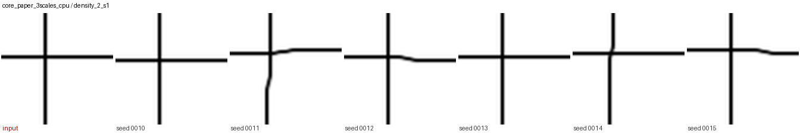


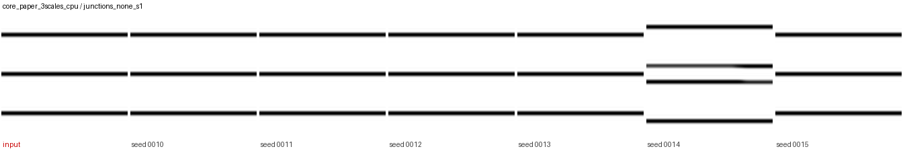

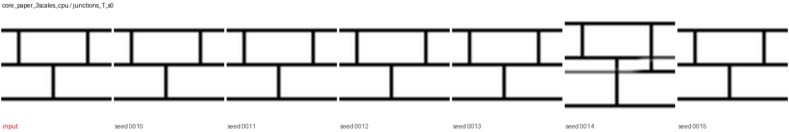


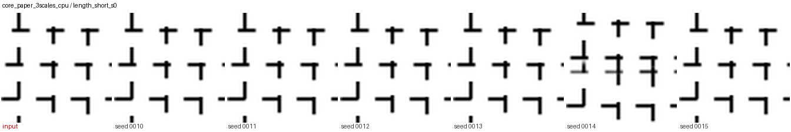

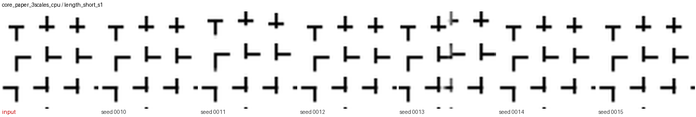

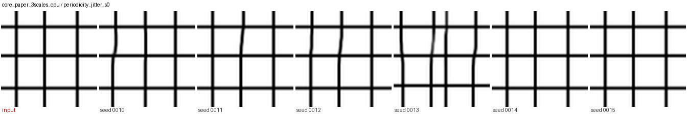

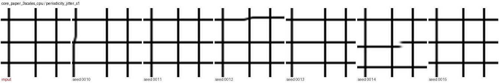

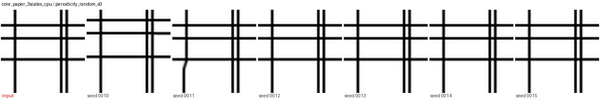

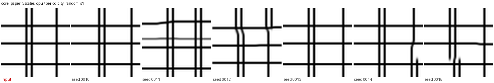

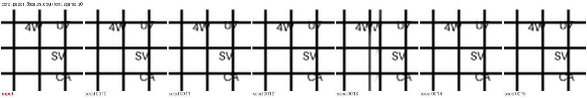

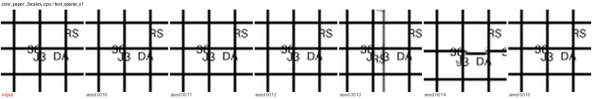


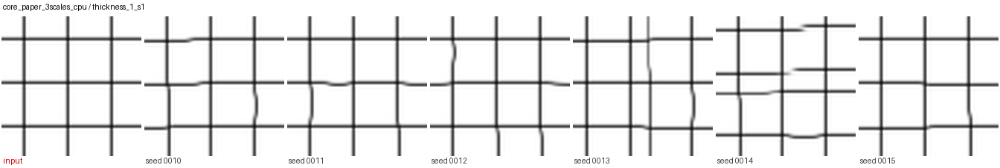


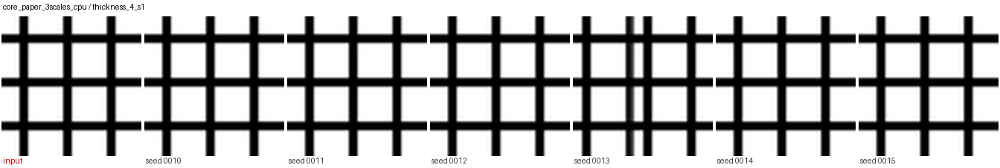


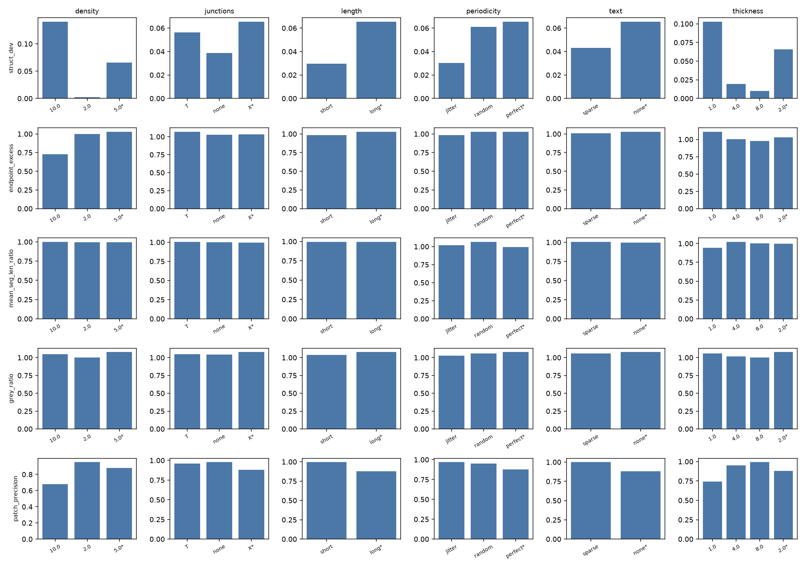
